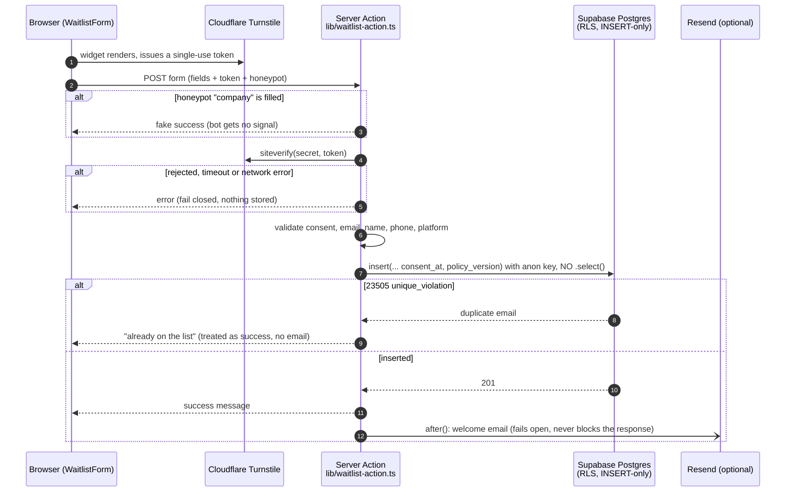

# nextjs-supabase-waitlist

A small, production-shaped waitlist landing page built with **Next.js (App
Router)** and **Supabase**. The brand is a placeholder ("Acme"); the interesting
part is how the form writes to the database:

- A **Server Action** inserts with the public **anon key**, into tables that are
  **INSERT-only** for that key (RLS + revoked grants). Nobody can read the list
  with the key that ships to the browser.
- The Supabase client lives in a **`server-only`** module.
- **Honeypot** field + **Cloudflare Turnstile** that **fails closed**.
- **Server-side validation** is the real gate; the disabled button and
  `required` attributes are only UX.
- A **consent record**: `consent_at` + `policy_version`, both set by the server,
  both **without a database default on purpose**.
- An **account deletion request** form (write-only table, same pattern).
- A **password reset** page for Supabase Auth recovery emails.
- An optional **welcome email** (Resend) that **fails open** and runs after the
  response with `after()`.
- **pgTAP tests** for the security model, and CI that runs them.

## Stack

| Tool | Version | Role |
|---|---|---|
| Next.js | 16.2.11 (App Router, Turbopack) | Framework, Server Actions |
| React | 19.2.4 | UI (`useActionState`) |
| TypeScript | ^5 | Language |
| Tailwind CSS | ^3.4 | Styles (tokens in `tailwind.config.ts`) |
| @supabase/supabase-js | ^2 | Inserts (Server Actions), Auth (reset page) |
| Supabase CLI | 2.x | Local stack, migrations, `supabase test db` |
| resend | ^6 | Optional welcome email |

No animation library: reveals use the native `IntersectionObserver`, the rest is
CSS.

## How a sign-up flows



## Quickstart

Prerequisites: Node.js 20.9+ (CI uses 22), Docker, and the
[Supabase CLI](https://github.com/supabase/cli).

```bash
# 1. Install dependencies
npm ci

# 2. Start the local Supabase stack. This applies supabase/migrations and seed.sql.
supabase start

# 3. Create your local env file
cp .env.example .env.local

# 4. Print the local credentials and copy API_URL and ANON_KEY into
#    NEXT_PUBLIC_SUPABASE_URL and NEXT_PUBLIC_SUPABASE_ANON_KEY in .env.local
supabase status -o env

# 5. Run the app
npm run dev        # http://localhost:3000
```

`.env.example` already contains Cloudflare's public Turnstile **test keys**, so
the form works locally without a Cloudflare account (see
[Turnstile test keys](#turnstile-test-keys)). `RESEND_API_KEY` can stay empty.

Submit the form, then look at the row in Supabase Studio
(`http://127.0.0.1:54323` → Table Editor → `waitlist_lead`). Studio connects as
an admin role, which is the point: the app itself can never read it back.

Run the database tests:

```bash
supabase test db   # or: npm run test:db
```

Other useful commands: `supabase db reset` (re-applies migrations + seed),
`npm run lint`, `npm run build`, `supabase stop`.

## Environment variables

| Variable | Exposed to browser? | Required | Purpose |
|---|---|---|---|
| `NEXT_PUBLIC_SUPABASE_URL` | yes | yes | Supabase API URL |
| `NEXT_PUBLIC_SUPABASE_ANON_KEY` | yes | yes | Anon key. Public by design; RLS protects the data |
| `NEXT_PUBLIC_TURNSTILE_SITE_KEY` | yes | yes | Turnstile widget key (public) |
| `TURNSTILE_SECRET_KEY` | **no** | yes | Turnstile verification secret, server-only |
| `RESEND_API_KEY` | **no** | no | Welcome email. Without it, sign-ups still work |
| `NEXT_PUBLIC_SITE_URL` | yes | no | Canonical URL for metadata, robots.txt and sitemap.xml |

> **`npm run build` does not check these.** `lib/supabase.ts` and
> `lib/turnstile.ts` throw when their variables are missing, but module-level
> code of a Server Action runs on the **first request**, not at build time. A
> deploy with missing variables builds green and fails when the first person
> submits the form. Set them in your hosting provider before deploying.

## Database

One migration, `supabase/migrations/20261117000000_waitlist_and_account_deletion.sql`:

**`waitlist_lead`**

| Column | Type | Notes |
|---|---|---|
| `id` | uuid | `gen_random_uuid()` |
| `email` | text | unique; lowercased by the Server Action |
| `name` | text | |
| `phone` | text | stored as typed |
| `platform` | text | CHECK `in ('android','ios')`; must match `lib/platform.ts` |
| `utm_source` | text | nullable, max 120 |
| `consent_at` | timestamptz | NOT NULL, **no default** |
| `policy_version` | text | NOT NULL, **no default** |
| `created_at` | timestamptz | `now()` |

**`account_deletion_request`**: `id`, `email` (**no unique on purpose**: asking
twice is legitimate), `confirmed_at` (NOT NULL, **no default**), `created_at`.

Length CHECKs are a safety ceiling, deliberately looser than the Server Action
(the product rule). The values marked `TODO(assumption)` in the migration are
template choices.

### Why INSERT-only RLS

Both tables are set up like this:

```sql
alter table public.waitlist_lead enable row level security;
revoke all on table public.waitlist_lead from anon, authenticated;
grant insert on table public.waitlist_lead to anon, authenticated;
grant select, delete on table public.waitlist_lead to service_role;
create policy "Public can insert waitlist leads"
  on public.waitlist_lead for insert to anon, authenticated with check (true);
```

The anon key is in your JavaScript bundle; anyone can copy it and call the REST
API directly. With this setup, all they can do is add a row: `SELECT`,
`UPDATE`, `DELETE` and `TRUNCATE` all fail with `42501`. Your list of emails
cannot be dumped with the key you hand to every visitor.

Why `REVOKE ALL` first: default privileges on new `public` tables depend on your
Supabase version. Older projects grant everything to `anon`/`authenticated`. The
local stack this was tested on (CLI 2.109, Postgres 17) no longer grants
SELECT/INSERT, but still grants `TRUNCATE`, `REFERENCES` and `TRIGGER`, and
**`TRUNCATE` is not subject to RLS**. Revoking everything makes the result
independent of those defaults. `service_role` bypasses RLS but still needs table
privileges, hence the explicit `GRANT SELECT, DELETE`.

#### The `.insert().select()` trap

```ts
// ❌ Fails with 42501 "permission denied for table waitlist_lead"
await supabase.from('waitlist_lead').insert(row).select()

// ✅ What the Server Actions do
await supabase.from('waitlist_lead').insert(row)
```

`.select()` (and `.single()`) asks PostgREST to return the new row
(`Prefer: return=representation`, i.e. `INSERT ... RETURNING`). Returning a row
requires `SELECT`, which anon does not have, so the request fails with HTTP 401
and code `42501`.

The statement is atomic, so **the row is NOT saved** either. This was verified
against the local stack: a plain `insert()` returned 201 and stored the row;
`insert().select()` returned 42501 and a `service_role` query found no row for
it. The pgTAP test `INSERT ... RETURNING ... fails for anon` and the next
assertion (`left no row behind`) cover the same thing at the SQL level.

The practical risk is a well-meant refactor: someone adds `.select()` "to get
the id", and every sign-up starts failing. That is why both Server Actions
carry a comment next to the insert.

### Consent record

`lib/waitlist-action.ts` validates the `consent` checkbox **on the server**
before touching any data, then inserts:

- `consent_at`: when consent was given (`new Date().toISOString()` on the server).
- `policy_version`: which document was accepted, from `POLICY_VERSION` in
  `lib/policy.ts`. The legal page shows the **same constant**, so the version
  on screen and the version stored cannot drift apart.

Neither column has a default **on purpose**. With a default, any insert (a
script, a future form, a refactor that skips validation) would silently record
consent nobody gave. Without it, such an insert fails with `23502`. The disabled
button and `required` checkbox in the browser are UX only; a direct POST to the
Server Action skips them.

Bump `POLICY_VERSION` every time the policy text changes. `app/legal/page.tsx`
is a **stub with example text**; replace it with your real Privacy Policy and
Terms.

### Reading the data

Use Supabase Studio or `service_role` from a trusted server, never the anon key:

```sql
select email, name, platform, consent_at, policy_version, created_at
from public.waitlist_lead order by created_at;

select email, created_at from public.account_deletion_request order by created_at;
```

## Account deletion request

App stores (Google Play, for example) require apps that let users create an
account to offer a way to request deletion. `/account-deletion` captures the
request; processing is manual. The page does not authenticate the requester:
whether the email matches a real account is verified when you process it.

- `components/AccountDeletionForm.tsx`: email + required confirmation checkbox +
  honeypot.
- `lib/account-deletion.ts`: validates the confirmation on the server, inserts
  `{ email, confirmed_at }`, no `.select()`.
- The "What gets deleted" list in `app/account-deletion/page.tsx` is marked
  `TODO`: it must match what your process actually deletes.

## Password reset page

`/reset-password` is the target of the Supabase Auth "Reset Password" email.
Your app calls `resetPasswordForEmail`; the change happens here, in the browser,
with the anon key.

Configure the template in the Supabase dashboard (Authentication → Email
Templates → Reset Password) so the link is:

```html
<a href="https://www.example.com/reset-password?token_hash={{ .TokenHash }}&type=recovery">
  Reset password
</a>
```

Flow (`app/reset-password/page.tsx`):

1. Missing `token_hash`, or `type` other than `recovery`: an error page.
2. A **Continue** button calls `verifyOtp({ token_hash, type: 'recovery' })`.
   It does **not** verify on page load, because mail scanners (Outlook Safe
   Links and similar) open links and would burn the single-use token.
3. New password + confirmation → `updateUser({ password })` → `signOut()`
   (global scope: it also ends sessions opened with the old password).
4. Expired, used or invalid token: a friendly message, never Supabase's raw text.

The recovery session is in memory only (`persistSession: false`). The route is
rendered per request (`connection()` in its layout), so it is served with
`Cache-Control: private, no-cache, no-store`, and it is `noindex`, disallowed in
`robots.ts`, and absent from the sitemap. `MIN_PASSWORD_LENGTH` (8) is only form
validation; Supabase's own minimum (Authentication → Providers → Email) is the
one that counts, and they should match.

## Security notes

- **The anon key is public by design.** It ships to the browser with the
  `NEXT_PUBLIC_` prefix. Security comes from RLS and grants, not from hiding it.
- **`service_role` never goes in this app.** It bypasses RLS. It is not used
  anywhere in the code; use it only on a trusted server or a script to read or
  process rows.
- **Server-only secrets:** `TURNSTILE_SECRET_KEY` and `RESEND_API_KEY` have no
  `NEXT_PUBLIC_` prefix, so Next never bundles them. `lib/turnstile.ts`,
  `lib/supabase.ts` and `lib/welcome-email.ts` import `'server-only'`, so
  importing them from a Client Component breaks the build. After a build, this
  should print nothing:

  ```bash
  grep -r "TURNSTILE_SECRET\|RESEND_API_KEY" .next/static/
  ```

- **Turnstile fails closed:** if Cloudflare cannot be reached (timeout, DNS,
  5xx), nothing is stored. The alternative would make the captcha decorative
  exactly when someone is attacking it.
- **The welcome email fails open:** it is scheduled with `after()` (it runs after
  the response) and swallows its own errors, so it can never block or break the
  insert. The name is HTML-escaped before it goes into the email body.
- **Honeypot:** a hidden `company` field. If it is filled, the action returns
  the same success message without doing anything.
- **Single-use tokens:** the form clears the Turnstile token on submit and
  resets the widget after an error, so retries do not fail with
  `timeout-or-duplicate`.
- **Headers:** `next.config.ts` sets `X-Frame-Options: DENY`,
  `X-Content-Type-Options: nosniff`, `Referrer-Policy` and `Permissions-Policy`,
  and disables `x-powered-by`.
- **JSON-LD** is serialized with `<` escaped to prevent `</script>` injection.

See [SECURITY.md](SECURITY.md) to report a vulnerability.

### Turnstile test keys

Cloudflare publishes dummy keys for development. They are public and not
secrets:

| Key | Value | Behavior |
|---|---|---|
| Site key | `1x00000000000000000000AA` | Always passes (visible widget) |
| Secret key | `1x0000000000000000000000000000000AA` | Always passes |
| Secret key | `2x0000000000000000000000000000000AA` | Always fails |

`.env.example` uses the "always passes" pair. Swap in the failing secret to test
the error path. **Replace both with your own widget's keys in production.**
Verification still calls Cloudflare's `siteverify` endpoint with test keys, so
local development needs internet access.

## Tests and CI

- `supabase/tests/*.test.sql` (pgTAP), run with `supabase test db`. They check
  that:
  - RLS is on.
  - anon and authenticated have only INSERT.
  - anon can insert but cannot SELECT, UPDATE, DELETE or TRUNCATE.
  - An insert without `consent_at`, `policy_version` or `confirmed_at` fails.
  - The platform CHECK and the unique email hold.
  - `INSERT ... RETURNING` fails and leaves no row.
  - service_role can read.
- `.github/workflows/ci.yml` has two jobs. **web** runs `npm ci`, `npm run lint`,
  and `npm run build` with dummy variables. **db** runs `supabase db start` and
  `supabase test db`, using `supabase/setup-cli`.

## Project structure

```
app/
  layout.tsx            fonts, metadata, ScrollProgress
  page.tsx              home: Hero, FAQ, WaitlistCTA (+ FAQPage JSON-LD)
  legal/page.tsx        STUB Privacy Policy / Terms, shows POLICY_VERSION
  account-deletion/     account deletion request page
  reset-password/       Supabase Auth recovery target (layout: noindex, no cache)
  opengraph-image.tsx   social card (lib/og-image.tsx)
  icon.svg, manifest.ts, robots.ts, sitemap.ts, not-found.tsx
components/
  WaitlistForm.tsx, AccountDeletionForm.tsx
  sections/             Header, PageHeader, Hero, FAQ, WaitlistCTA, Footer
  Logo.tsx, FadeIn.tsx, Reveal.tsx, ScrollProgress.tsx
lib/
  waitlist-action.ts    Server Action: waitlist
  account-deletion.ts   Server Action: deletion request
  supabase.ts           server-only anon client
  turnstile.ts          server-only Turnstile verification (fail closed)
  welcome-email.ts      server-only Resend email (fail open)
  platform.ts           allowed platform values (shared with the CHECK)
  policy.ts             POLICY_VERSION
  site.ts               brand name, tagline, URLs, emails
  faq.ts, og-image.tsx
supabase/
  config.toml, seed.sql (empty), migrations/, tests/
assets/                 fonts for the OG card (OFL)
```

## Rebranding

Edit `lib/site.ts` (name, tagline, URL, contact and email addresses),
`components/Logo.tsx` and `app/icon.svg`, colors in `tailwind.config.ts`, the
FAQ in `lib/faq.ts`, and replace `app/legal/page.tsx` with your real documents.

## Deploying

Any Next.js host works. Set all the variables from the table above in your
host first (remember: the build will not warn you). Link your Supabase project
and push the migration with `supabase link` and `supabase db push`, then run the
pgTAP tests against a local stack before every schema change.

## License

- Code: [MIT](LICENSE).
- Fonts in `assets/` (Plus Jakarta Sans): SIL Open Font License 1.1, see
  [`assets/OFL.txt`](assets/OFL.txt). The site itself loads Plus Jakarta Sans and
  JetBrains Mono through `next/font/google` (both OFL).
